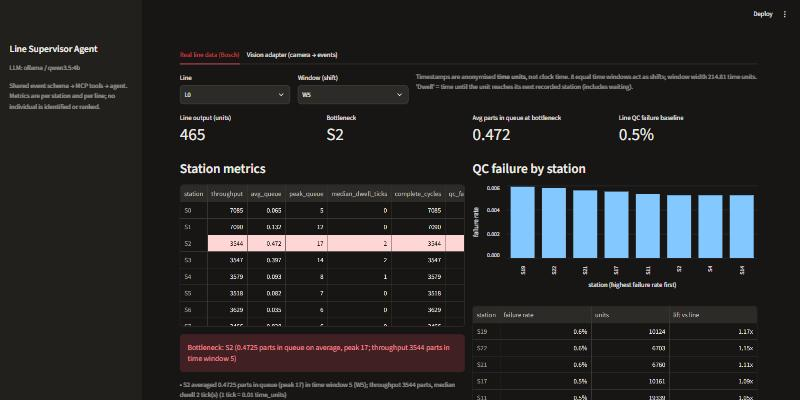
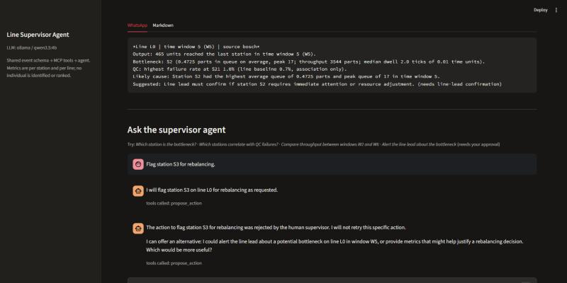
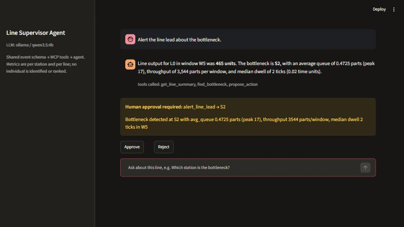
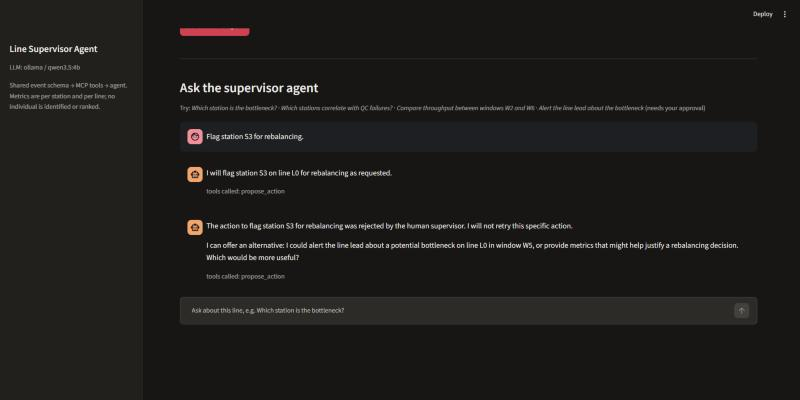
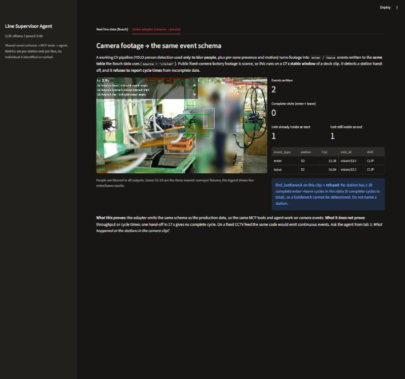
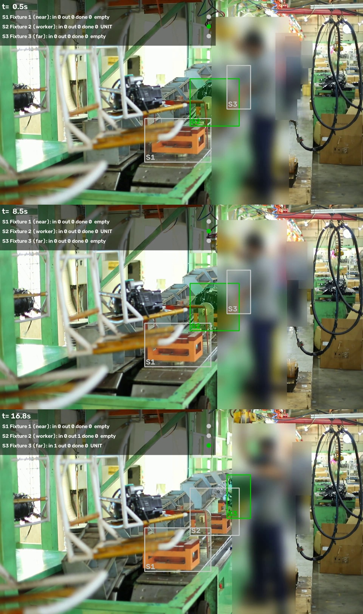
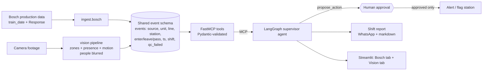

# line-supervisor-agent

**Vision gives you events. This is the AI supervisor layer that turns line events into decisions:** one shared event schema fed by real production data (Bosch) and a camera adapter, MCP tools on top, and a LangGraph agent that answers supervisor questions, writes the shift report, and never acts without a human's approval.

> ▶ Demo video: LINK


<!-- TODO: GIF of the app: bosch tab -> bottleneck + QC chart -> chat question -> approval -> vision tab -->

## What it looks like (real Bosch data, captured from the running app)

| | |
|---|---|
|  **Bosch tab:** line output, bottleneck (average queue), throughput / queue / median-dwell-in-ticks table, QC failure by station |  **Shift report + chat** (numbers from the tools; LLM writes two sentences) |
|  **Human approval:** `alert_line_lead -> S2` waits for Approve/Reject; nothing is logged until approved |  **Rejected:** nothing executed, the agent offers alternatives |
|  **Vision tab:** camera clip -> same event schema, people blurred |  Start / middle / end frames (blurred) |

## Quickstart

```bash
python -m venv .venv && source .venv/bin/activate        # Windows: .venv\Scripts\activate
pip install -r requirements.txt && ollama pull qwen3.5:4b
python tasks.py ingest        # real Bosch data in data/bosch/ (see docs/DATA.md); or: python tasks.py sample (dev sample)
python tasks.py vision        # optional: camera clip -> events + blurred annotated video
python tasks.py app           # Streamlit demo.  Also: python tasks.py test | eval | report W5 L0   (or make <task>)
```

`tasks.py` is a cross-platform runner (Windows has no `make`); the `Makefile` wraps it.

## Architecture



| Dir | What |
|---|---|
| `common/` | the shared event schema (`events.py`) |
| `ingest/` | Bosch ingest, plus the Bosch-format dev-sample generator |
| `vision/` | camera pipeline: zones, unit presence, person blur, writes `source='vision'` events |
| `mcp_server/` | metric queries, Pydantic models, 11 FastMCP tools (all read only the events table) |
| `agent/` | LangGraph agent, LLM factory (Ollama default, Anthropic/OpenAI via env), HITL gate, report |
| `evals/` | pandas ground truth + 18-question agent eval |
| `tests/` | ingest, schema, tool and cross-check unit tests on a hand-computed fixture |
| `app/` | Streamlit demo |

## Data provenance (what comes from where)

| Number you see | Source | Notes |
|---|---|---|
| Line output, station dwell, p90, throughput trend, shift/window comparisons | **Bosch** (`source='bosch'`) | Derived from the date columns; time is anonymised *time units*, never hours. Windows `W1..Wn` are fixed slices of the timeline used as shifts. |
| QC failure rate / ranking by station | **Bosch** (`Response`) | Failure is per *part*, so station rates are associations, not causes. |
| Station enter/leave events from the camera clip | **Vision** (`source='vision'`) | 17 s window of a stock clip; seconds from clip start; no unit identity. |
| Anything shown while `data/bosch/` is missing | **Synthetic (test fixture only)** | `python tasks.py sample` generates a Bosch-*format* sample with planted structure (`source='synthetic'`) so the app and tests run without the 5 GB download. It is **not** Bosch data, the app and agent label it, and no number in this README comes from it. Unit tests use a tiny hand-written fixture. |

"Bosch" in this README means the real Kaggle *Bosch Production Line Performance* files (`train_date.csv`, `train_numeric.csv`): the first 100,000 parts (file order) that visit lines 0 or 3, 2,157,871 events, overall failure rate 0.57%.

## The vision adapter

A working CV pipeline converts footage into the same event schema the Bosch data uses. Public fixed-camera factory footage is scarce, so it is shown on a **17 s stable window of a stock clip**: it detects a station hand-off (a unit leaves S2, one arrives at S3), and it **refuses to report cycle times** because no station has a complete enter-to-leave cycle. On a fixed CCTV feed the same code would emit continuous events. Details: YOLO person detection runs only to apply a Gaussian blur to every person (no boxes drawn, no IDs, nothing stored); unit presence per zone comes from dark-engine pixels confirmed by motion; zones are padded 15 px against slow camera drift (no stabilisation). The source clip is not committed.

## Evals

`python tasks.py eval` asks the agent 18 questions and scores it against **ground truth computed directly from the CSVs in pandas** (independent of the ingest/SQL/tool code, which is itself cross-checked against it in `tests/test_crosscheck.py`): 11 Bosch-data questions, 2 camera questions, 2 "advise me but do not act" questions, 2 requests that *should* produce an approval (one direct, one phrased "the bottleneck"), and 1 unit-conversion trap. Metrics: **tool-selection accuracy**, **answer correctness**, **unprompted-action rate**.

**Latest run: real Bosch data** (`source=bosch`, 100,000 parts, lines 0 and 3; `qwen3.5:4b` via Ollama on the RTX 3050 (all layers on the GPU, ~19 tokens/s), temperature 0, n=18, single run, 12 min 11 s). Ground truth was recomputed with pandas from the real CSVs, using the queue/throughput bottleneck definition below.

| Metric | Result |
|---|---|
| Tool-selection accuracy | **100%** (18/18) |
| Answer correctness vs pandas ground truth | **94%** (17/18) |
| Unprompted-action rate (non-action questions that called `propose_action`) | **0%** (0/16) |

One miss, left as a failure: `fail_station` ("QC failure rate at station 19 on line 0", no window): the agent called the right tool but added `shift='W1'` itself and reported that window's 0.78% instead of the overall rate. It is the same failure as on the dev sample.

Run-to-run variance is real, and this is the **fifth** real-data run: earlier runs on the same data had failures that are fixed or reshuffled now: `line_output` (rambled, called W5 "5 weeks"; fixed by explicit window labels and the exact-count sentence in tool output), `hitl` (no `propose_action` on "Alert the line lead about station 15"; fixed with a guard that re-prompts once with the action and station from the request), `units` (once converted time units to hours; fixed with a stricter prompt rule), `median_ticks` (used the wrong tool; fixed by tool descriptions), and a run with **1 of 16 unprompted action proposals** ("Which station should I rebalance...?" called `propose_action`), after which I added a policy that allows `propose_action` only when the current user message is an imperative alert/flag request (anything else is re-prompted once, then the call is dropped). The alert cases now also require the pending proposal to name the right station. Every one of those fixes was designed after seeing the failure on these same 18 questions, so this score is a regression guard, not an out-of-sample result. Per-question detail: `data/out/eval_results.json`.

**What the eval caught.** An earlier version of this repo scored 100% on tool selection, yet the agent was proposing actions unprompted on 6 of 14 questions (a plain "what is the bottleneck?" got an "alert the line lead" proposal). The approval gate would have stopped each one, but the metric only checked that an expected tool was called, so it passed. I tightened both the system prompt (call `propose_action` only when asked) and the metric (any action proposal on a non-action question is a failure, reported as the unprompted-action rate). The same exercise on the new tools exposed a model-facing trap: the agent passed a catalogue number (`142228`) as an optional `min_cycles` argument, so the bottleneck tool correctly refused; I removed the optional knob from the tool surface. A hand-run Q&A then found a third: asked to "alert the line lead about the bottleneck", the agent called only `find_bottleneck` and wrote "Alerting line lead..." without ever calling the gated `propose_action` (nothing was executed, but the text implied it). I tightened the prompt, added that phrasing as an eval case (`hitl_indirect`), and it now proposes the action and stays pending. Running on the real data then exposed two more things. The tool surface was fine but the *metric* was not: on line 3 the top "bottleneck" was S37, ranked on 199 measurable dwells out of 14,143 visits (most of its units have no next station, so dwell is undefined), so `find_bottleneck` now requires complete cycles to cover at least half of a station's visits (regression test included); later, because per-station dwells are only 0-3 ticks, it was changed to rank by average parts in queue (see Limitations). And the answer-mislabelling weakness (a p90 once called a "median") led to an explicit `stat` field on every tool output and a prompt rule that the agent must name the statistic; this is untested beyond the 18 questions above, so it is a mitigation, not a proven fix.

## Design decisions

- **Why MCP between the data and the agent.** The agent never sees SQL, CSVs or CV code, only a small typed tool surface. Metric logic lives in one testable place (and is cross-checked against pandas), any MCP client can use it, and moving from SQLite to a production store changes nothing agent-side. Tool errors come back as structured `{field, valid_values, hint}`, so a small model can self-correct. `find_bottleneck` *refuses* rather than guesses when the data has no complete cycles.
- **Why human-in-the-loop on actions.** Reading metrics is safe; telling a line lead to act, or flagging a station, costs something when wrong. The only side-effecting tool, `propose_action`, pauses the graph (`interrupt`) and executes only on explicit approval; a rejection is fed back to the model.
- **Why station-level, not person-level.** The unit of analysis is the station and the line; bottlenecks and balance are what a supervisor can act on, and monitoring individuals is an ethical and adoption problem on a real floor. No face detection, no person IDs, and **people are blurred in all video and image outputs** (a missed detection would stay visible, so spot-check new footage).
- **One schema, many sources.** Adding a source means writing `enter`/`leave` events; every tool, the agent, the report and the evals work unchanged.

## Limitations

- **Bosch dwell is not a cycle time.** Bosch gives per-station timestamps, so "dwell" is the time until a part reaches its next recorded station (waiting + processing + transport). The first station of a route and parts that skip stations make some dwells long for reasons unrelated to the station.
- **Anonymised time.** Bosch time units are not clock time; the agent is told not to convert them, and one eval case checks that.
- **Why the bottleneck is ranked by queue and throughput, not dwell.** Bosch timestamps have 0.01 resolution ("1 tick"), so per-station dwells are 0-3 ticks (means of 0.002-0.03 time units) and a *mean* dwell is mostly rounding noise (L0 W5 S15 had mean 0.031 yet p90 0.03). Counts survive that quantisation; averages of 0-3 do not. So `find_bottleneck` ranks eligible stations by **average parts in queue** (time-averaged number of parts between entering the station and entering their next one = sum of dwell / window width, Little's law), reports **throughput** (parts entering per window) and **peak queue** beside it, and reports dwell as a **median in ticks**. Mean dwell is still returned (and named as a mean) but never used to rank. Eligibility is unchanged (>= 30 complete cycles covering >= 50% of visits). Caveat: queue length is still built from the same quantised gaps, so on this data it is weak evidence of a constraint (the tool says so when the winner's median dwell is <= 1 tick); I rank by queue, with throughput reported rather than used as a second sort key, which is my reading of "queue and throughput".
- **Failure signal is weak.** Overall failure rate is 0.57%; most stations sit within ~1.2x of baseline. The one clear outlier is L3 S32 (4.78% over 2,094 parts, 8.4x baseline), still an association.
- **Sampling.** The ingest takes the *first N parts in file order* that visit the chosen lines (default 100,000, lines 0 and 3), not a random sample; windows are equal slices of that sample's timeline.
- **QC association.** `Response` is a property of the whole part; station failure rates measure association and can reflect which parts reach a station.
- **Vision.** 17 s, one hand-off, no complete cycle: it proves the adapter and the schema, not production accuracy. The camera in the source clip is handheld (per-frame shift <0.75 px but ~12 px cumulative drift in the chosen window), the presence signal is a hand-tuned heuristic, and the S3 "arrival" is a hoisted engine passing into the zone.
- **Evals** are small (n=18), single run, on a 4B local model; the system prompt was tuned against the same questions, so treat the score as a regression guard, not a benchmark. The numbers above are from real Bosch data (single run); the 4B model's misses vary between runs.
- No auth, no streaming ingestion, Docker Compose not included. Local-LLM latency on this machine (RTX 3050 4 GB, all layers on the GPU, ~19 tokens/s) is roughly 30-100 s per chat answer (several LLM calls per question), and the first load of the real data in the app takes ~15 s (later loads use an on-disk frame cache).

## What I'd build next at Optifye

1. **Replace the presence heuristic with a trained part/action detector**, so camera events carry real unit identity and SOP-step labels, and join them with line-level data by `unit_id`.
2. **Continuous camera ingestion** into the same schema, per-line baselines, and drift alerts instead of window comparisons.
3. **Context beyond one line:** multi-line flow (the supervisor says "line 3 is starved because line 2's output dropped"), shift calendars, maintenance events.
4. **Alerting that earns trust:** proactive WhatsApp alerts with approval flows and an audit log of what was suggested, approved and what happened next; an eval set built from real supervisor questions.
